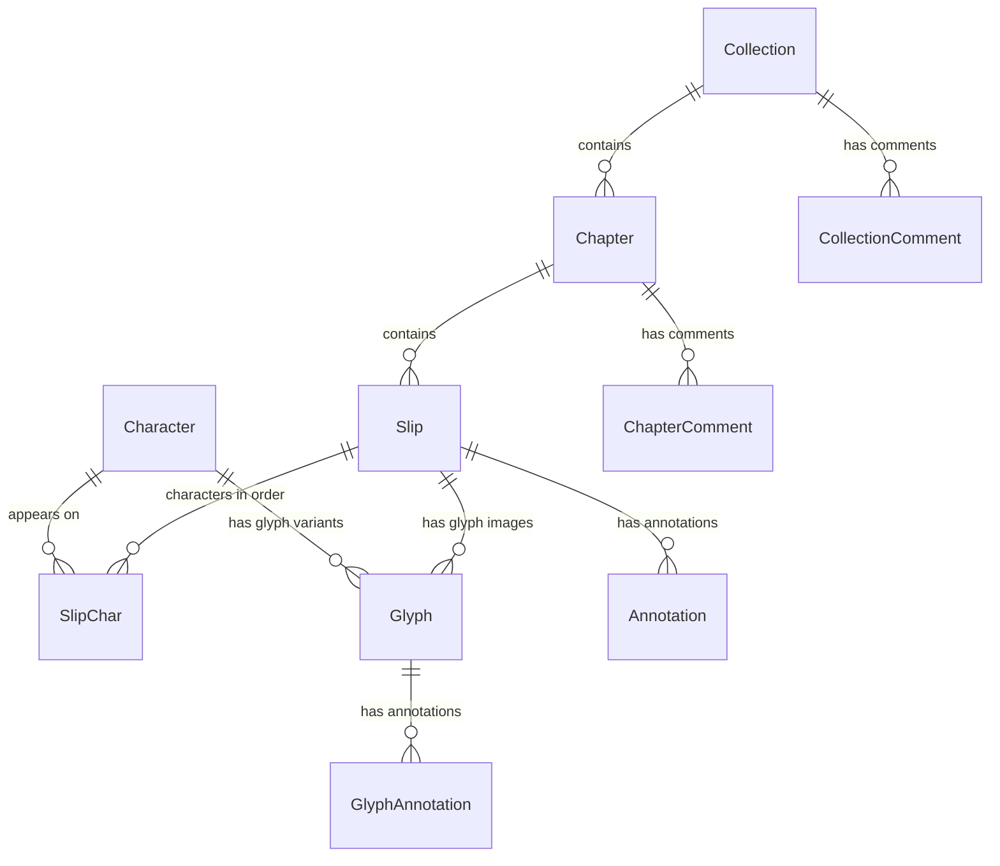

# 📜 先秦出土文献数据库

> 把竹简释文、上古音、字形图版与集释放进同一套「篇—简—字」结构的 Django 项目。
> 目标是做成文字编、辞典与语料库联动的系统（参照 [ePSD2](https://oracc.museum.upenn.edu/epsd2/) 的思路）。

首次接触网页开发时的练习项目，目前托管于 [PythonAnywhere](http://aengmore.pythonanywhere.com)。与 DeepSeek 网页端共创（说白了是它手把手教出来的）。

---

## 目录

- [当前规模](#当前规模)
- [功能](#功能)
- [技术栈](#技术栈)
- [目录结构](#目录结构)
- [快速开始](#快速开始)
- [环境变量](#环境变量)
- [数据模型](#数据模型)
- [API](#api)
- [语料维护：从 document.md 到数据库](#语料维护从-documentmd-到数据库)
- [增补篇目的流程](#增补篇目的流程)
- [简序的处理](#简序的处理)
- [部署](#部署)
- [测试](#测试)
- [已知问题与计划](#已知问题与计划)
- [参考文献](#参考文献)

---

## 当前规模

| 项 | 数量 |
|---|---|
| 批次（Collection） | 1（上博简） |
| 篇目（Chapter） | 63 |
| 竹简（Slip） | 1009（见 `document.md`） |
| 释文字符 | 约 34,900 |
| 字头（Character） | 11,000+ |
| 字位（SlipChar） | 32,000+ |

语料以上博简为主，逐篇据《上海博物馆藏楚简校注》校录；简序研究见 [下文](#简序的处理)。

---

## 功能

- **篇目管理**：批次 → 篇 → 简三级组织，支持调整分篇与编联顺序（后台可拖拽）
- **释文浏览**：篇—简—字三级浏览，关键词全文检索、结果高亮、随机一简
- **上古音注音**：声母、韵部、读音，在释文中以振假名样式显示
- **图文对照**：竹简图版、古文字字形图、隶定字动态组字（IDS）与释文对照
- **集释系统**：前台提交释读意见与证据，管理员审核后展示，支持置信度、评论与点赞
- **字符索引**：点击释文中的字，查看音韵、字形、字频与出现位置
- **REST API**：只读接口 + 评论提交，供 Vue 前端与外部脚本使用

---

## 技术栈

| 层 | 选型 |
|---|---|
| 后端 | Python 3.14、Django 6.0.7、Django REST Framework 3.18 |
| 数据库 | SQLite（开发／小规模）；PostgreSQL（生产，`psycopg`） |
| 前端 | Vue 3.5、Vue Router 4、Vite 8（独立目录 `../frontend`） |
| 静态资源 | WhiteNoise；生产由 PythonAnywhere 映射 `/static/` |
| 后台增强 | django-admin-sortable2（拖拽排序）、django-markdownx / markdownify（集释 Markdown） |
| 其它 | django-cors-headers、django-filter、openpyxl / pandas（表格导入）、waitress（Windows 部署） |

---

## 目录结构

```
web/
├── bamboo/                 # 项目配置（settings / urls / wsgi / asgi）
├── texts/                  # 主应用
│   ├── models.py           # 数据模型
│   ├── views.py            # 服务端视图（SPA 壳 + 随机一简）
│   ├── api_views.py        # DRF 接口
│   ├── serializers.py
│   ├── admin.py            # 后台配置（含 sortable）
│   ├── spa.py              # SPA 入口
│   ├── static/ templates/  # 页面与样式
│   └── migrations/
├── frontend/               # Vue 3 + Vite（与 bamboo/ 同级）
├── signlist/               # 字形／字表素材
├── datasource/             # 校注 PDF 等原始资料（不入库）
├── drafts/                 # 待校核的新篇目草稿
├── document.md             # 语料主文件（导入源）
├── import.py               # 语料导入脚本
├── db.sqlite3              # 开发数据库
└── Dockerfile
```

---

## 快速开始

### 后端

```powershell
cd d:\program\web\bamboo
.\venv\Scripts\activate            # 或直接 .\venv\Scripts\python.exe
python -m pip install -r requirements.txt
python manage.py migrate
python manage.py runserver 8000
```

### 前端

```powershell
cd d:\program\web\frontend
npm ci
npm run dev
```

访问 Vite 输出的地址（默认 <http://localhost:5173>），API／媒体／静态请求由 Vite 代理到 Django 的 8000 端口。
生产构建输出到 `texts/static/texts/vue/`，访客 URL 仍由 Django 返回 Vue 入口。

### 常用命令

```powershell
python manage.py createsuperuser     # 建后台账号
python manage.py makemigrations      # 改模型后
python manage.py migrate
python manage.py collectstatic --noinput
python import.py --file document.md  # 导入语料
```

---

## 环境变量

| 变量 | 默认 | 说明 |
|---|---|---|
| `DJANGO_DEBUG` | `True` | 生产必须设为 `False` |
| `DJANGO_SECRET_KEY` | 无 | `DEBUG=False` 时必填，否则启动即失败 |
| `DJANGO_ALLOWED_HOSTS` | `localhost,127.0.0.1,testserver` | 逗号分隔 |
| `DB_ENGINE` | `django.db.backends.sqlite3` | 设 `django.db.backends.postgresql` 切 PG |
| `DB_NAME` | `db.sqlite3` | 数据库名／路径（可指向副本做试验） |
| `DB_USER` / `DB_PASSWORD` / `DB_HOST` / `DB_PORT` | — | PostgreSQL 连接 |

> 想在不碰正式库时试导入，把 `DB_NAME` 指到副本即可：
> `$env:DB_NAME="$env:TEMP\test.db"; python import.py --file document.md`

---

## 数据模型



| 模型 | 关键字段 |
|---|---|
| `Collection` | `name`(unique)、`description`、`order` |
| `Chapter` | `title`(unique)、`description`、`slip_order`(JSON 编联顺序)、`collection` |
| `Slip` | `slip_id`、`content`、`chapter`、`order`、`source`、`parallel_text`、`image` |
| `SlipChar` | `slip`、`character`、`glyph`(可空)、`position`、`status`；`unique_together(character, slip, position)` |
| `Character` | `reading`、`initial`、`rhyme`、`pronunciation`／`pronunciation_ascii`、`glyph_image`、`ids`、`meaning`；`unique_together(reading, pronunciation)` |
| `Glyph` | `image`、`source`、`notes` |
| `Annotation` / `GlyphAnnotation` | 类型、标题、正文、证据、作者、`is_approved`、`confidence`、`likes` |

> **注意**：`SlipChar.glyph` 是**可空**外键（`SET_NULL`）。导入只写"字头 + 位置"，字形图由 Glyph 模块另行挂接。
> 早期导入脚本报 `NOT NULL constraint failed: texts_slipchar.glyph_id`，就是这里没有 `null=True`，已由迁移 `0024_slipchar_glyph_nullable` 修正。

---

## API

只读接口，分页参数 `page`、`page_size`（默认 20，上限 200）。

| 接口 | 说明 |
|---|---|
| `GET /api/home/` | 首页统计（篇数、简数、字数、集释数等） |
| `GET /api/slips/` | 简列表；`chapter`、`collection`、`slip_id` 过滤，`q` + `search_in=all\|content\|slip_id\|character` 检索 |
| `GET /api/slips/{id}/` | 单简详情（含字位序列） |
| `GET /api/slips/{id}/annotations/` | 该简已审核集释（分页） |
| `GET /api/chapters/` | 篇目列表；`collection` 过滤，`include_slips=1` 附带简目 |
| `GET /api/collections/` | 批次列表；`include_slips=1` 附带简目 |
| `GET /api/characters/` | 字头列表；`q` + `search_type=glyph\|reading` |
| `GET /api/glyphs/` | 字形列表 |
| `GET /api/csrf/` | 取 CSRF token |
| `POST`（评论） | 提交集释／评论，管理员审核后展示 |

SPA 路由（`/`、`/all/`、`/chapters/`、`/slip/<id>/`、`/character/<id>/`、`/search/`、`/dictionary/` 等）统一由 `spa_app` 接管；`/random/` 为随机一简。

---

## 语料维护：从 document.md 到数据库

`document.md` 是**唯一语料源**，结构极简：

```text
## 上博简                 ← 批次（Collection）
### 鬼神之明              ← 篇目（Chapter）
1:今夫鬼神有所明……       ← 竹简（Slip）：简号 + 冒号 + 释文
2:富有天下……
5墨節上:曰“鬼神有所明”……
```

### 导入规则（`import.py`）

- `## ` → 批次；`### ` → 篇目；`chapter: 篇名` 亦可
- 每行按 `|` → `.` → `:` → `：` 依次尝试切分简号与释文
- 简号以数字开头时自动加篇名（`1` → `鬼神之明1`）；否则原样使用（`港3`、`甲19`、`王1`）
- 释文中的标点（，。、；：？！《》〔〕等）跳过，不生成字位
- 同一简已有字位时**跳过**，不重复插入；**不删除**库里多余的旧简
- 字形字段留空，等 Glyph 模块补

### 简号写法约定

| 写法 | 含义 |
|---|---|
| `1`、`2` | 整简 |
| `7上` / `8下` | 同一支简的上段／下段（中段残断） |
| `3背`、`1背` | 简背（篇题或背文），按原书位置排列 |
| `6+2`、`3+4`、`29+24下` | 缀合简（书中的拼合编号） |
| `缺` | 缺简占位 |
| `脫1`、`殘1`、`逸1` | 脱简／残简／逸简 |
| `附簡` | 篇末附简 |
| `港3`、`港大1` | 港大藏简 |
| `甲1`、`乙3`、`王1`、`志1`、`命4`、`成16`、`孔9` | 分卷（甲/乙本）或同组简的篇别前缀 |

释文中：`□` 表残字，`……` 表阙文，`〔〕` 为补文（导入时去括号、留字）。

### 导入后检查与重建

```powershell
python manage.py shell -c "from texts.models import Slip, SlipChar; print(Slip.objects.count(), SlipChar.objects.count())"
```

若某篇后来重切／重排导致简号变化，旧简会留在库里。需要干净重建时，先删该篇旧简再导：

```powershell
python manage.py shell -c "from texts.models import Slip; Slip.objects.filter(chapter__title='曹沫之陳').delete()"
python import.py --file document.md
```

---

## 增补篇目的流程

目前这套（相对可靠）的做法：

1. **取释文**：从 `datasource/` 的校注 PDF 抽取。正文层可用时按字号分层——释文 12pt、注释 10.5pt、篇题 20pt、页眉 8/9pt——只取 12pt 即可把注释整块滤掉。
2. **字形转写**：书里的古文字形多为嵌图，读法在 `（）` 中。取括号内的通行字：`古字（通行字）` → 通行字，`（A→B）` → B，`〔补文〕` → 去括号留字。
   括号前那个字是不是"字形字"，看间距：紧邻（<8pt）多是字形本身，隔一个字位（约 10–12pt）则是正文后接字形图。
3. **切简**：按书的 `【N】`／`【N 背】` 标记切分（标记在简末）；`【釋文與註釋】` 之类的分卷标题去掉。
4. **成稿**：写入 `drafts/`，按 `document.md` 体例；**简末不补句号**——两简连读就让它连着。
5. **校核**：逐页对照图版核一遍（字形叠置、跨行括号、跨页切点最易出错），确认后并入 `document.md` 再导入。

> 已并入：上博简 63 篇；`drafts/李頌.md` 中另有 16 篇新篇目草稿待校核。

---

## 简序的处理

- 默认按《上海博物馆藏楚简校注》的编联顺序；
- **例外：《曹沫之陳》采用安大簡（《安徽大學藏戰國竹簡（二）》）同文異本所确认的简序**。旧简序已被证明有误，现行顺序：
  `1, 2, 3, 37下, 41, 4, 5, 6, 7上, 8下, 9…22, 25, 37上, 23下, 24上, 30, 26, 62, 58, 49, 33…36, 28, 48, 46下, 38…46上, 27, 63上, 47, 23上, 51下, 29+24下, 50…57, 15, 16, 59, 60上, 63下, 64, 65上, 7下, 8上, 65下`
  其中 `58 → 49` 连读为「所以同死於民」，是这次调整的关键证据之一；
- 参考：李鵬輝《據安徽大學藏戰國竹簡〈曹沫之陳〉談上博簡相關簡文的編聯》（《文物》2022 年第 3 期）、單育辰《〈曹沫之陳〉新編聯及釋文》（簡帛網，2007）。

---

## 部署

### PythonAnywhere

```powershell
npm --prefix ..\frontend ci
npm --prefix ..\frontend run build
python manage.py collectstatic --noinput
```

Web 配置里把 `/static/` 映射到 `STATIC_ROOT`；媒体文件需平台静态映射或独立文件服务器。新增静态文件或重建 Vue 后要重跑 `collectstatic`。

### Docker

构建上下文需同时包含同级的 `bamboo/` 与 `frontend/`，从 `web/` 目录执行：

```powershell
docker build -f bamboo/Dockerfile -t bamboo .
```

运行时仍需传入生产密钥、允许的主机与数据库配置。

### 生产要点

- `DJANGO_DEBUG=False`、`DJANGO_SECRET_KEY`、`DJANGO_ALLOWED_HOSTS` 必填；
- 密钥用 `python -c "import secrets; print(secrets.token_urlsafe(50))"` 生成，不要入库；
- 静态文件走 WhiteNoise，媒体文件另配。

---

## 测试

```powershell
python manage.py test texts
```

`texts/tests.py` 覆盖模型与主要视图；API 测试可用 `testserver` 免 host 校验。

---

## 已知问题与计划

- [ ] `import.py` 不删除旧数据，重切后需手动清理（可加 `--prune`）
- [ ] 语料仍有录入重复（如《曹沫之陳》简2「堯之堯之」、《季庚子》末段重文），待逐句清理
- [ ] `Character` 与 `SlipChar` 缺批量维护界面，音韵信息靠后台逐条补
- [ ] Glyph 与 SlipChar 的对应仍以图片为准，动态组字（IDS）只覆盖部分字
- [ ] `drafts/` 中 16 篇新篇目待人工校核后并入
- [ ] 除《曹沫之陳》外，其余各篇仍沿用校注本简序，若见新材料可再校

---

## 参考文献

- 陈伟 等：《楚地出土战国简册（十四种）》，经济科学出版社，2009
- 俞绍宏：《上海博物馆藏楚简校注》，中国社会科学出版社，2016
- 李鵬輝：《據安徽大學藏戰國竹簡〈曹沫之陳〉談上博簡相關簡文的編聯》，《文物》2022 年第 3 期
- 單育辰：《〈曹沫之陳〉新編聯及釋文》，簡帛網，2007
- 安徽大學漢字發展與應用研究中心：《安徽大學藏戰國竹簡（二）》，中西書局，2022
- ……

---

## 许可与致谢

个人学习项目，代码可自由取用；语料部分请遵守原书版权。
感谢 DeepSeek 网页端在开发过程中的全程指导，以及简帛网（bsm.org.cn）公开的讨论与研究资料。
